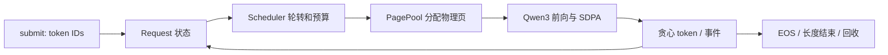

# 独立推理核心 v0.1

2026-09-09 重写底层。新的 `qil/` 不导入、不包装、不继承历史
`nano_vllm/` 里的任何运行时类；历史代码见标签 `legacy-nano-vllm`。

## 模块与数据流

- `config.py`：直接解析 checkpoint JSON，拒绝未适配的架构选项。
- `cache.py`：物理页表、KV tensor、容量额度、各层写入进度与所有权。
- `model.py`：独立模块结构与显式 checkpoint 参数映射。
- `attention.py` / `paged_attention.py`：dense、长度分组及可选 Triton 直接分页 Decode Attention。
- `scheduler.py`：Request/Work 数据结构、请求接入、轮转、token 预算和终止。
- `engine.py`：执行 Work、记录输出、回收失败/取消请求、同步 token 事件。
- `__main__.py`：文本或 token IDs 命令行入口。

## 数值与缓存不变量

Qwen3 的 head_dim 不必等于 hidden_size / num_attention_heads，线性投影维度按显式 head_dim
构造。Q/K 分别按每头归一化；RoPE 使用绝对 token 位置。默认 SDPA 路径展开 GQA KV 头，
可选 paged Decode 则直接在内核内把 query head 映射到 KV head。
带历史缓存的多 token query 显式构造 key_position <= query_position 的因果 mask，
避免短 query 使用错误的因果对齐。

写缓存必须连续，每层记录写到的 token 数；不能读取未写入的前缀。
每个请求的物理页面独占，释放后归还页池；复用时清空写入长度，旧数据不可见。
物理页按 computed token 数增加，容量额度在接入时按 prompt + max_new_tokens - 1 预留。
最后一个生成 token 无需再做 forward，因此不占额外 KV 位置。
这种额度预留较保守，但确保所有已接入请求都有继续推进的空间。

调度计划一轮内每个 active 请求最多取一个块，执行后的请求排到末尾。
Prefill 用 chunk/token 预算限制，Decode 每次一个 token。新请求可在两次 step 之间接入。
2026-09-19 新增同轮跨请求 Decode 合批，详见 [BATCHED_DECODE](BATCHED_DECODE.md)。
2026-09-20 新增 Prefill 按需输出投影，见 [SELECTIVE_LOGITS](SELECTIVE_LOGITS.md)。
同日增加 Decode 长度分组及直接分页 Attention，见 [PAGED_ATTENTION](PAGED_ATTENTION.md)。
没有基于重算的抢占或容量超售；模型执行失败时回收整个执行组（单请求或合批成员），
未参与失败执行组的请求仍可通过后续 step 继续。generate 的异常退出会取消该次提交的剩余请求。

## 独立性与来源

“从零”指推理引擎代码的独立实现，不指从零训练 Qwen，也不指手写矩阵乘法或 GPU 驱动。
运行时基础依赖为 PyTorch 和 SafeTensors；文本入口可选 Transformers tokenizer。
可选的 paged Decode 模式另需 Triton；默认 CPU/dense/grouped 路径不导入它。
正确性测试使用 Transformers 的 Qwen3 模型作为外部参考，正式执行核心不用它的 forward/generate。

模型结构依据公开架构配置与参考实现核对：

- [Qwen3-0.6B 官方配置](https://huggingface.co/Qwen/Qwen3-0.6B/blob/main/config.json)
- [Transformers 4.55.2 Qwen3 参考实现](https://github.com/huggingface/transformers/blob/v4.55.2/src/transformers/models/qwen3/modeling_qwen3.py)

标准 Transformer/RoPE/GQA 算法不作为原创算法声明。仓库以前基于 nano-vllm-lite 的历史仍保留在
PROVENANCE、Git 历史和标签 `legacy-nano-vllm` 中，不将历史扩展或历史性能结果归到新核心。

## 验收证据

- 小型随机 Qwen3：不同 head_dim、GQA、共享权重/独立 LM Head、attention bias。
- 全 Prefill / token-by-token / 不规则 chunks 的 logits 与 Transformers 对齐：
  float32 atol=2e-6、rtol=2e-5。
- 三种 token/chunk/cache 预算下，混合输入长度的完整贪心输出一致。
- EOS、动态接入、运行/等待取消、容量拒绝、执行异常后的资源回收。
- 分片 SafeTensors 加载，缺权重、错误形状、未知参数、冲突共享权重均拒绝。
- 禁止旧框架和 Transformers 导入的子进程仍能完成实际模型生成。
- 构建 wheel 后检查仅包含 qil 与包元数据；再从隔离安装位置运行 tiny checkpoint。

2026-09-09 基线：30 项独立核心测试通过。全仓 74 项通过、1 项 CUDA 模块跳过。
新增 Decode 合批的 CPU 验证单独记录于 [BATCHED_DECODE](BATCHED_DECODE.md)。
CPU 数据基于随机小模型，不能代表训练好的 0.6B 模型质量或 GPU 性能。
随后完成真实 Qwen3-0.6B GPU 冒烟，详见下方结果。

## 真实模型 GPU 冒烟（2026-09-09）

- 设备：NVIDIA GeForce RTX 4080 SUPER，单卡；Float32。
- 环境：PyTorch 2.8.0+cu128、Python 3.12.3。
- 模型：Qwen3-0.6B 官方 checkpoint。
- 输入：5 tokens 的短提示和 198 tokens 的数字检索提示。
- 分块：每组分别使用 chunk_size=1 和 32，token_budget=64、max_active=2。
- 生成：每个请求贪心生成 8 tokens，忽略 EOS；四组 token IDs 均与 Transformers 完全一致。
- 短输入最后位置 logits：最大绝对误差 1.71661376953125e-5，平均绝对误差 2.8622112040466163e-6。
- 两轮混合请求完成后，全部 256 个 KV 页面回收断言通过。

[原始 GPU JSON](../benchmarks/results/2026-09-09/independent_gpu.json)保存输入、输出、时间戳及源码哈希。
这是有限正确性冒烟，没有覆盖 BF16、长上下文、持续请求压力或性能对照。

随后完成的[独立核心与 vLLM 对照](independent-vllm-comparison-2026-09-09.md)补充了 FP32 eager
性能基线：四类回答、三次重复的 30 条性能生成序列均一致；当前独立核心在单请求和四请求
吞吐上均落后于 vLLM。该对照仍没有覆盖 BF16、长上下文或持续请求压力。

## 下一阶段

1. BF16 逐层定位、RoPE 舍入修复、同后端/同缓存参考验收及性能对照已完成，见
   [第三轮报告](bf16-gpu-validation-2026-09-20.md)。原跨路径数值阈值失败仍保留；
   下一步扩展长上下文、执行形状和请求压力验证。
2. Decode 合批的 FP32 GPU 验收已完成，见 [GPU 报告](batched-gpu-validation-2026-09-20.md)；
   按需 logits 和输出层 profiling 已完成，见 [第二轮报告](prefill-gpu-validation-2026-09-20.md)。
   下一步消融 Prefill 同步/索引开销，再评估 Prefill 合批。
3. 独立 Decode paged-attention 已作为可选路径完成，见 [分页 GPU 报告](paged-gpu-validation-2026-09-20.md)。
   继续扩展精度/模型覆盖及性能验证，再评估 CUDA Graph。
4. 在独立核心上重建混合负载回放与策略消融；现有历史回放器不能直接声称适用于新 API。

这是实验性推理引擎。独立分页 Decode 内核已完成限定配置验收，CUDA Graph、前缀共享和多卡优化尚未完成。
